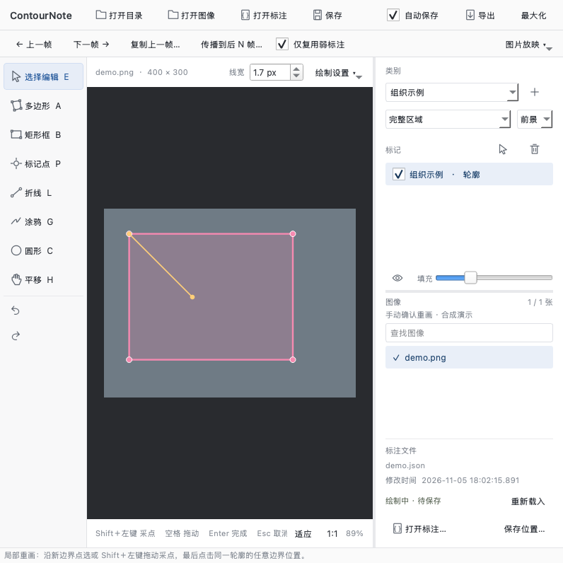

# ContourNote · 临绘

An offline manual image annotation workspace. Application version: **0.5.2**; use the **licensefix1 packaging revision**. Supports full regions, weak point/box/line/scribble cues, live Labelme-compatible JSON saving, COCO, and masks. No AI models or cloud inference are included.

[简体中文](README.zh-CN.md) · [Changelog (Chinese)](CHANGELOG.md) · [Current release notes](docs/releases/v0.5.2-licensefix1.md) · [Known issues](docs/KNOWN-ISSUES.md) · [Validation](docs/VALIDATION.md) · [MIT license](LICENSE)

> This is a trial build. Custom annotation directories can carry over between projects, and Windows cross-drive saving has a known path issue. Windows has not undergone native runtime acceptance testing. The application UI is Chinese; English documentation is not an English language pack.



## Download and run

Check the repository's [Releases page](https://github.com/SmalllerWKM/ContourNote/releases) for assets actually published by the maintainer. Local build records do not imply that release assets have been uploaded.

| Platform | Runtime archive | Launch |
|---|---|---|
| macOS Apple Silicon arm64 | ContourNote-macOS-arm64-v0.5.2-licensefix1.zip | Extract and open 临绘 0.5.2 许可证修订.app |
| Windows x64 | ContourNote-Windows-x64-v0.5.2-licensefix1.zip | Extract everything, open CN, run 临绘.exe |
| Developer source | ContourNote-source-v0.5.2-licensefix1.zip | Create an environment and install dependencies |

Runtime packages include Python and Qt. Keep the Windows runtime and app directories beside the EXE. The Mac package is ad-hoc signed, not Apple Developer signed or notarized. No Intel Mac, Windows ARM64, or Linux standalone package is provided.

## Designed around everyday annotation habits

ContourNote supports an initial annotation followed by human review and local
correction. These are implemented workflow choices, not measured claims of
clinical accuracy or annotation speed.

| Annotator habit | Current interaction |
|---|---|
| Inspect details while moving around an image | Wheel zoom, hand/middle-button pan, F to fit, and a resizable canvas |
| Trace an anatomical boundary continuously | Hold Shift + left mouse button; accepted vertices are saved individually |
| Finish a region without interrupting the gesture | Near-start auto-close, right-click or Enter; undo can reopen the draft |
| Correct only an inaccurate boundary segment | E to edit nodes; double-click a boundary to redraw a section and click the original edge to choose the retained region |
| Provide sparse supervision when a full contour is unnecessary | Boxes, points, lines and scribbles alongside full regions; foreground/background cues |
| Work through adjacent frames | Visible previous/next/copy/propagate controls, with manual inspection after coordinate reuse |
| Check that edits reached disk | Default JSON autosave, actual modification time and annotated-image checkmarks |
| Use project-specific categories | User-defined labels and existing Labelme category import |
| Avoid the dark exterior of an endoscopic field | Adjustable view inset, a visible preview and boundary projection when detection succeeds |

## Two workflows: annotator and reviewing editor

| User | Work | Main tools |
|---|---|---|
| Annotator | Create initial contours and weak supervision cues | A Polygon, B Box, P Point, Shift + left-button tracing |
| Reviewing editor | Improve an existing annotation by moving nodes or replacing a local boundary | Open existing JSON, E Edit, node dragging or double-click boundary redraw |

A reviewer can correct one segment of a previously annotated endoscopic boundary:
start by double-clicking its node/edge, draw the replacement, **click another point
on the original edge**, and select the retained region from the two previews.
Other annotations remain available; a complete delete-and-redraw is unnecessary.

The two users exchange the same editable Labelme JSON. They are workflow roles,
not accounts, permissions or a before/after dataset-diff system. Autosave updates
the current JSON. Duplicate the complete project into a separate working folder
before handoff when initial and reviewed datasets must both be preserved.
See the [annotator/reviewer guide](docs/ANNOTATOR-REVIEWER.md).

## Current workflow

1. Open an image directory, image, or supported Labelme JSON. Add your own labels; none are predefined.
2. Use A for a polygon, B for a box, or P for a point. Choose full regions or weak foreground/background cues as appropriate.
3. Click vertices or hold Shift and drag with the left mouse button. New polygons can close near their start, with right-click, or with Enter.
4. Use E to edit. Drag a node, or click an edge to add and drag a node. Double-click an existing polygon node/edge to start redrawing.
5. **Click another point on the original boundary to confirm the redraw.** Hovering or dragging near it does not confirm. Select the retained region from the blue/orange preview.
6. A notice can be dismissed without discarding the draft. Esc cancels; Ctrl+Z undoes. Tab toggles Edit/Polygon while the canvas has focus.

The old add/merge/subtract controls and cut-mode checkbox were removed in 0.5.0. The record page and generated judgment, confidence, review, quality, and note fields were removed in 0.5.2.

## Field of view and persistence

The optional view detector uses radial luminance profiles, adaptive fade rejection, robust angular processing, and an inset. Defaults are 4 original-image pixels and 35% rejection strength. A cyan dashed contour previews the result. Out-of-view samples project to the nearest contour segment; nearby interior samples can also snap. Detection can be inaccurate under unusual optics, occlusion, or very dark images; inspect the preview or disable it.

Accepted annotation vertices are stored individually without polynomial fitting or contour simplification. Default spacing is 8 screen pixels, adjustable from 2 to 40.

Autosave is enabled by default and can be disabled. Complete edits save immediately; draft/drag writes are throttled at approximately 220 ms. Actual modification times, external-change notices, previous-version .json.bak files, and draft recovery are provided. A completion checkmark does not prove the latest changes are on disk.

Large-project label/status indexing runs in the background. Frame-copy tools only copy coordinates between equal-sized images and require manual review. F5 controls an optional 0.1-120 second/image slideshow.

## Formats

Supported Labelme shapes: polygon, rectangle, circle, point, line, and linestrip. Other extensions such as mask and oriented_rectangle are not supported.

Exports contain image copies, editable Labelme JSON, annotations.json for COCO regions/detection boxes, weak_annotations.json, masks/, weak_masks/, and classes.json. Weak boxes have empty COCO segmentation arrays and a custom supervision field; points and lines are stored separately from COCO instances.

Masks use 0 for background, 1-254 for foreground classes, and 255 for unknown/ignore. With no full region, the semantic mask is unknown. In 0.5.2, legacy clinical metadata is preserved opaquely and no longer controls validation or background-mask generation. Always read the mapping from the same export.

## Shortcuts

E Edit · A Polygon · B Box · P Point · L Line · G Scribble · C Circle · H Pan · Tab Edit/Polygon · F Fit · 1 100% · F11 Fullscreen · W/D Previous/Next · F5 Slideshow · Ctrl+S Save · Ctrl+Z Undo.

On macOS, Ctrl combinations normally map to Command. Input fields keep their editing behavior. Press F1 for more shortcuts.

## Development and verification

Python 3.10+ is required. From the project root:

```sh
python -m venv .venv
# macOS / Linux
.venv/bin/python -m pip install -e '.[test]'
.venv/bin/python run.py
# Windows
.venv\Scripts\python.exe -m pip install -e ".[test]"
.venv\Scripts\python.exe run.py
```

The local v0.5.2 record is 75 passing tests plus a native frozen Mac startup/save/export/render check. Windows validation is static. An optional upstream Labelme reference test is skipped when that external checkout is absent. These checks do not establish clinical accuracy or quantified annotation efficiency.

For manual GitHub publication, see the [upload guide (Chinese)](docs/GITHUB-MANUAL-UPLOAD.zh-CN.md). Original source is MIT-licensed; dependencies retain their own licenses. Labelme is an external interaction/format reference; see [NOTICE](NOTICE.md).

## Complete version history

[CHANGELOG](CHANGELOG.md) and the [per-version notes](docs/releases/README.md) cover every local milestone. Dates below are local build dates, not publication dates.

| Version | Main changes | Local date |
|---|---|---|
| [0.5.2-licensefix1](docs/releases/v0.5.2-licensefix1.md) | Licenses and corresponding source; two-workflow guide and complete history links | 2026-11-05 |
| [0.5.2](docs/releases/v0.5.2-licensefix1.md) | Click-confirmed redraw and removable notices; record UI removed | 2026-11-05 |
| [0.5.1](docs/releases/v0.5.1.md) | Out-of-view projection and redraw closure fixes | 2026-11-05 |
| [0.5.0](docs/releases/v0.5.0.md) | Gradient-aware view and unified boundary editing | 2026-11-05 |
| [0.4.1](docs/releases/v0.4.1.md) | Region-operation workflow fixes | 2026-11-03 |
| [0.4.0](docs/releases/v0.4.0.md) | Background indexing, local split and closure undo | 2026-11-03 |
| [0.3.0-winfix1](docs/releases/v0.3.0-winfix1.md) | Windows extraction-path repair | 2026-11-03 |
| [0.3.0](docs/releases/v0.3.0.md) | Adaptive layout, visible frame controls and portable apps | 2026-11-02 |
| [0.2.1](docs/releases/v0.2.1.md) | Standalone Mac runtime and launcher repair | 2026-11-02 |
| [0.2.0](docs/releases/v0.2.0.md) | Simpler UI, auto-close and file state | 2026-11-02 |
| [0.1.0](docs/releases/v0.1.0.md) | Initial manual annotation workspace | 2026-11-02 |

## Third-party licensing

See [THIRD_PARTY_NOTICES](THIRD_PARTY_NOTICES.md) and the [replacement/rebuild guide](licenses/REPLACING-LIBRARIES.md). The licensefix1 revision includes license texts, a visible in-app license viewer and a separate free Qt/PySide6/GEOS corresponding-source download.
