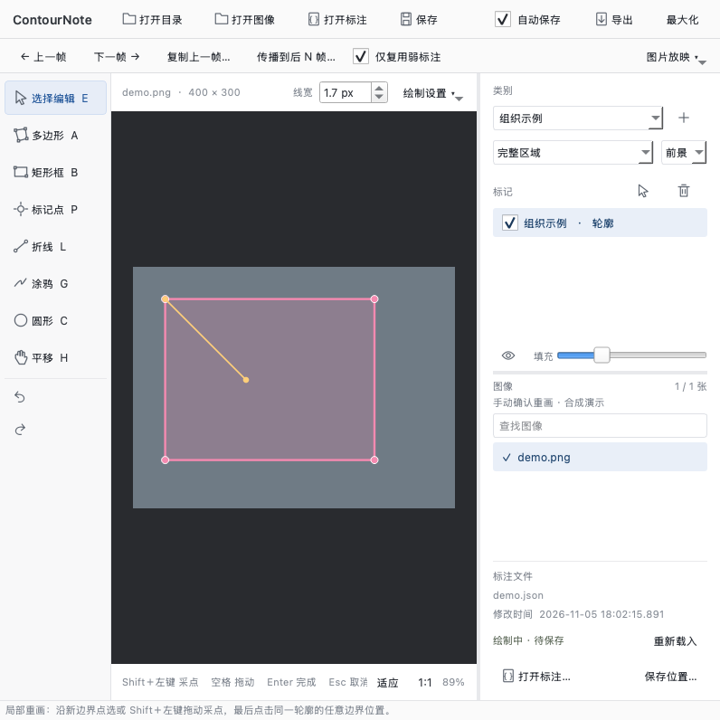

# 临绘 · ContourNote

本地人工图像标注工具，当前应用版本 **0.5.2**，推荐下载 **licensefix1 许可证修订包**。支持完整轮廓与点、框、线、涂鸦等弱提示，自动保存 Labelme 兼容 JSON，并导出 COCO、语义 Mask 和弱提示 Mask。没有 AI 模型或云端推理。

[English](README.md) · [完整更新日志](CHANGELOG.md) · [当前版本说明](docs/releases/v0.5.2-licensefix1.md) · [各版 Release 文案](docs/releases/README.md) · [已知问题](docs/KNOWN-ISSUES.md) · [验证范围](docs/VALIDATION.md) · [MIT](LICENSE)

> 当前作为试用版本提供。跨项目自定义保存目录和 Windows 跨盘保存存在已知问题；Windows 包尚未实机验收。中英文文档不代表英文界面，软件界面目前为中文。



## 下载与启动

请在项目 [Releases 页面](https://github.com/SmalllerWKM/ContourNote/releases) 查看维护者实际已发布的附件；本地构建记录不代表附件已上传。

| 平台 | 当前运行包 | 启动方式 |
|---|---|---|
| Mac Apple 芯片 arm64 | ContourNote-macOS-arm64-v0.5.2-licensefix1.zip | 解压后双击“临绘 0.5.2 许可证修订.app” |
| Windows x64 | ContourNote-Windows-x64-v0.5.2-licensefix1.zip | 完整解压，进入 CN，双击“临绘.exe” |
| 开发源码 | ContourNote-source-v0.5.2-licensefix1.zip | 创建 Python 环境后运行 |

运行包包含 Python、Qt 和依赖，无需自行创建 .venv。Windows 请保留 EXE 旁边的 runtime 和 app 文件夹，避免深层解压路径。Mac 包为本地 ad-hoc 签名，未做 Apple 开发者证书签名或公证。目前没有 Intel Mac、Windows ARM64 或 Linux 独立运行包。

## 围绕标注者习惯设计

临绘面向“先标注、再审查修改”的人工工作方式。以下是当前已有的操作设计，不代表已经通过临床效率对照试验。

| 常见标注习惯 | 临绘中的对应操作 |
|---|---|
| 边观察边移动、放大局部 | 滚轮缩放，小手/中键平移，F 适应窗口；窗口和画布随尺寸调整 |
| 沿组织轮廓连续描画 | Shift＋鼠标左键拖动逐点采样；接受的顶点逐点保存，不用拟合曲线替代 |
| 画完立即结束 | 接近起点自动闭合，也可右键或 Enter 完成；Ctrl＋Z 可退回闭合前草稿 |
| 审查时只改错的一小段 | E 选择编辑：拖动节点、边线加点；双击边界重画局部，点击原边界后选择保留区域 |
| 用较少操作提供弱监督信息 | 矩形框、点、线、涂鸦与完整轮廓并存，区分前景/背景提示 |
| 连续处理相邻帧 | 顶部常显上一帧、下一帧、复制上一帧与向后传播；复制后逐帧人工检查 |
| 确认修改是否真正保存 | 默认自动保存 JSON，显示保存状态与真实修改时间；已标注图片显示勾选 |
| 每个项目使用自己的类别 | 不预设前景类别，用户添加；读取已有 Labelme 类别继续工作 |
| 圆形内窥镜视野外不落点 | 可调有效视野内收；识别成功时，黑区落点吸附到有效边界，检测结果可预览 |

## 标注者与审查修改者：沿用原结果进行修正

| 使用者 | 关注的工作 | 推荐入口 |
|---|---|---|
| 标注者 | 建立初始轮廓及框、点等弱提示 | A 多边形、B 矩形框、P 标记点，Shift＋左键连续采点 |
| 审查修改者 | 检查现有标注，在原有基础上修正坐标点或一段边界 | 打开已有 JSON → E 选择编辑 → 拖动节点或双击边界局部重画 |

例如，一段脊柱内窥镜组织轮廓画偏了：审查者可双击该段起点，沿正确边缘补画，
再**单击原轮廓另一处边线**，在蓝/橙预览中选择保留区域；其他已完成的标注继续保留。

两类使用者共享 Labelme JSON，不需要转换为另一套标注格式。这是流程分工；当前没有人员账号、
权限或初标/复核差异版本系统。自动保存更新当前 JSON；若需分别留存初标与复核数据，交接前复制完整项目到独立目录。
详见[双角色操作说明](docs/ANNOTATOR-REVIEWER.md)。

## 五步开始

1. 打开图片目录、单张图片或已有 Labelme JSON。目录不递归扫描，支持 PNG、JPEG、BMP、TIFF、WebP。
2. 输入自己的类别并回车，或点击“＋”。不预设前景类别，导入时收集已有类别。
3. A 绘制多边形，B 画框，P 标点；右侧区分完整区域与弱提示、前景与背景。
4. 左键逐点点击，或 Shift＋左键拖动采点。新建多边形支持接近起点自动闭合，也可右键或 Enter 完成。
5. 检查保存状态与修改时间，然后导出。demo/ 是合成演示，不是真实病例。

## 选择编辑与边界重画

- E 进入选择编辑；单击节点拖动，单击边线可添加并拖动节点。
- 双击已有完整多边形节点或边线开始重画，逐点或 Shift＋左键描绘新边界。
- **点击原轮廓另一处边线才确认终点**，随后按蓝、橙预览选择保留区域。仅靠近、悬停、经过或拖动经过不会自动弹窗。
- 无效路径会保留草稿并说明原因；黄色提示条可“关闭提示”，不会丢弃草稿。Esc 取消，绘制中 Ctrl＋Z 撤回一点。
- Tab 在画布内切换选择编辑与多边形；输入框内保留正常 Tab 行为。

补画/合并/扣除入口和“折线切分”开关已在 0.5.0 移除。0.5.2 没有“记录”页面，也不再生成判断、置信度、审核、质量或备注。历史行为查阅更新日志。

## 有效视野边界

针对圆形等带暗色填充的视野，使用径向亮度、渐变阈值及角向稳健处理。默认内收 4 原图像素、剔除强度 35%，绘制设置可调整或关闭。青色虚线表示检测结果。

吸附开启且检测成功时，无效区落点投影到最近有效边线；有效区内距边缘 10 屏幕像素内也可吸附。该约束不等于裁剪整个形状面积，已有轮廓仍需人工核对。偏心、多个视野、遮挡或极暗图像可能检测不准。

采样间距默认 8 屏幕像素，可调 2-40 px。**实际接受的标注顶点逐点保存，不做多项式拟合或轮廓简化。** 视野检测结果会复用，改变设置或切图时重新计算。

## 保存、图片列表与连续帧

自动保存默认开启，可关闭；手动保存为 Ctrl＋S。显示真实文件修改时间，内容未变时不重写 JSON。绘制/拖动保存约 220 ms 节流，未完成路径保存在 .contour-drafts/；覆盖保存保留上一版 .json.bak。实时保存不保证断电零丢失。

外部修改会提示冲突，需重新载入或确认覆盖。已标注图片显示勾选，但勾选不代替磁盘保存状态；0.5.2 以形状或 Labelme flags 判定，不再以旧记录字段判定。

大项目的类别和勾选后台索引，切帧不全量重扫。上一帧、下一帧、复制和向后 N 帧传播在顶部；帧复用只复制坐标，不跟踪运动，来源与目标尺寸需一致。图片放映在菜单中，可设 0.1-120 秒/张，F5 开始/暂停。

## 数据兼容与导出

Labelme 兼容类型：polygon、rectangle、circle、point、line、linestrip。未支持 mask、oriented_rectangle 等扩展形状；Labelme 不会自动理解临绘的弱提示语义。

| 文件/目录 | 含义 |
|---|---|
| images/、labelme/ | 图片副本与可继续编辑的 Labelme JSON |
| annotations.json | COCO 完整区域或弱检测框，附加 supervision 字段 |
| weak_annotations.json | 点、线、涂鸦及其他弱提示 |
| masks/、weak_masks/ | 完整区域语义 Mask 与弱提示 Mask |
| classes.json | 本次导出的类别映射 |

Mask 约定：0 背景，1-254 前景类别，255 未知/忽略。没有完整区域时语义 Mask 为 255，弱标注不等于负样本。旧 clinical 字段原样透传，但 0.5.2 不再用其中“无目标”自动生成全背景 Mask。类别编号可能随类别集合改变，始终读取同次 classes.json。

弱框 COCO segmentation 为空，只能作为检测提示；点、线等在独立弱提示文件中，不冒充精确分割真值。

## 快捷键

| 操作 | 快捷键 |
|---|---|
| 编辑 / 多边形 / 框 / 点 | E / A / B / P |
| 线 / 涂鸦 / 圆 / 小手 | L / G / C / H |
| 编辑与多边形切换 | Tab（画布有焦点时） |
| 采点 / 完成 / 取消 | Shift＋左键 / 右键或 Enter / Esc |
| 上一帧 / 下一帧 | W 或方向左/上 / D 或方向右/下 |
| 适应 / 100% / 全屏 | F / 1 / F11 |
| 保存 / 撤销 / 重做 | Ctrl＋S / Ctrl＋Z / Ctrl＋Y 或 Ctrl＋Shift＋Z |
| 放映开始或暂停 | F5 |

Mac 的 Ctrl 组合通常对应 Command，Alt 对应 Option。更多按键按 F1 查阅。

## 开发与验证

需要 Python 3.10+，在项目根目录执行：

```sh
python -m venv .venv
# macOS / Linux
.venv/bin/python -m pip install -e '.[test]'
.venv/bin/python run.py
# Windows
.venv\Scripts\python.exe -m pip install -e ".[test]"
.venv\Scripts\python.exe run.py
```

```sh
# macOS 开发环境中的无窗口测试
QT_QPA_PLATFORM=offscreen .venv/bin/python -m pytest -q
```

本地 0.5.2 测试记录为 75 项通过，Mac 独立应用保存/导出/渲染通过；Windows 仅静态包与依赖检查。外部 Labelme 对照测试在没有参考仓库时会跳过，数量可能不同。详见 [验证说明](docs/VALIDATION.md)。

## 完整版本更新

[完整逐条日志](CHANGELOG.md)和[各版本说明](docs/releases/README.md)覆盖全部历史节点。以下日期是本地构建日期，不能当作 GitHub 实际发布日期。

| 版本 | 主要变化 | 本地日期 |
|---|---|---|
| [0.5.2-licensefix1](docs/releases/v0.5.2-licensefix1.md) | 许可证与对应源码、双角色流程说明、全部版本入口 | 2026-11-05 |
| [0.5.2](docs/releases/v0.5.2-licensefix1.md) | 手动确认重画、可关闭提示、移除记录页面 | 2026-11-05 |
| [0.5.1](docs/releases/v0.5.1.md) | 无效视野落点投影与重画闭合修复 | 2026-11-05 |
| [0.5.0](docs/releases/v0.5.0.md) | 渐变有效视野与统一边界编辑 | 2026-11-05 |
| [0.4.1](docs/releases/v0.4.1.md) | 区域运算真实操作流程修复 | 2026-11-03 |
| [0.4.0](docs/releases/v0.4.0.md) | 后台索引、折线切分、闭合撤销与视野吸附 | 2026-11-03 |
| [0.3.0-winfix1](docs/releases/v0.3.0-winfix1.md) | Windows 解压路径修复包 | 2026-11-03 |
| [0.3.0](docs/releases/v0.3.0.md) | 自适应工作区、可见帧操作与双平台运行包 | 2026-11-02 |
| [0.2.1](docs/releases/v0.2.1.md) | Mac 独立应用与启动入口修复 | 2026-11-02 |
| [0.2.0](docs/releases/v0.2.0.md) | 简约界面、自动闭合与文件状态 | 2026-11-02 |
| [0.1.0](docs/releases/v0.1.0.md) | 初始人工标注工作台 | 2026-11-02 |

## 发布与许可证

[手动上传步骤](docs/GITHUB-MANUAL-UPLOAD.zh-CN.md)说明仓库文件与 Release 附件如何放置。历史日志不表示历史版本已在 GitHub 发布。

独立源码采用 MIT，依赖遵循各自许可证。Labelme 为交互与格式参考，没有将其应用源码或图标复制进本项目。见 [NOTICE](NOTICE.md)。

第三方版权与 LGPL 权利、对应源码及替换方式见 [第三方组件说明](THIRD_PARTY_NOTICES.md)和 [licenses](licenses/REPLACING-LIBRARIES.md)。许可证修订版随应用免费提供 Qt/PySide6/GEOS 对应源码附件，应用内左下角可打开“开源许可”。
