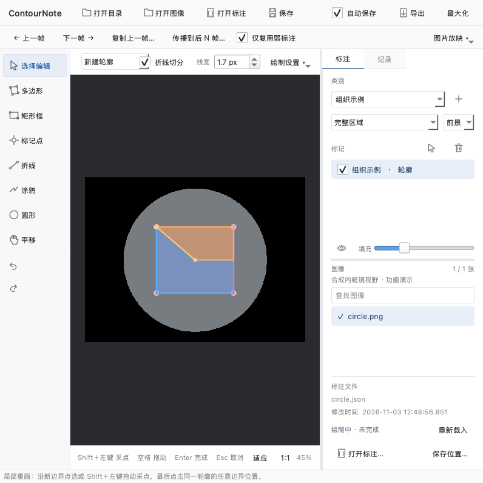
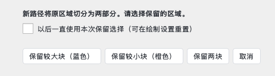

# 临绘 0.4.0 使用与验证说明

## 这次的四项调整

1. 编辑模式上方新增“折线切分”开关。勾选后点击已有完整多边形的节点开始，沿区域内部逐点或 Shift＋左键拖动画线，终点点击或触及原轮廓任意边界即可。蓝色表示较大块，橙色表示较小块；弹窗可保留较大块、较小块或两块，也可取消。勾选“以后一直使用本次保留选择”后随项目保存；在“绘制设置”中重置。关闭切分编辑可继续拖动节点。
2. 大于 100 张的项目在后台读取 JSON 的类别与标注状态，状态栏显示进度。首张图可以先标注，其余勾选逐批更新；切换图片只更新当前项，不再重新读取全部 JSON。列表使用批量添加与固定行高。
3. 自动闭合后立即按 Ctrl＋Z（Mac 对应 Command＋Z），撤销闭合并恢复闭合前的全部草稿点；再次撤销才减少最后一个点。手动完成的普通形状仍按原有文档撤销规则处理。
4. 自动检测与图像外框连通、各 RGB 通道均不超过 12 的近黑填充，以识别内窥镜圆形等有效视野。多边形采点接近边缘 8 屏幕像素或进入填充时，落点吸附至有效视野边缘。可在“绘制设置”关闭“吸附有效视野边界”。没有 AI 或组织语义分割。内部未连通外框的黑色小区域不会当作外围填充。

保留依据采点间距实际接受的每个顶点，完整坐标逐点写入 JSON；不做多项式拟合、轮廓简化或存储压缩。取消旧版 5000 点限制。视野检测为提高速度最多在 1024 边长缩略图上计算，再映射回原图，因此高分辨率输入边界位置有离散误差；黑边阈值对极暗组织、渐变遮罩或灰色填充可能不适用，应人工检查并按需关闭。

## 平台文件

- macOS Apple 芯片：`临绘-macOS-Apple芯片-v0.4.0.zip`，内含 `临绘 0.4.app`。
- Windows x64：`ContourNote-Windows-x64-v0.4.0.zip`，完整解压后进入 `CN` 双击 `临绘.exe`。
- Windows 保留短路径打包检查与 QML 冗余剔除规则，运行时目录结构不要拆开移动。Windows 尚未实机启动验收。

## 验证

新增测试覆盖：编辑模式从节点切到边线、两部分面积、元数据保留、撤销、取消与越界路径、记住选择和项目重开、自动闭合撤销及草稿落盘、圆形黑边与内部黑洞、超过 5000 顶点原样保存、大项目后台读取线程。

合成压力检查：30,000 个图片列表条目，29,999 份空形状 JSON，首张有实际合成图片；在本机测试中，列表与首张加载约 0.166 秒，随后 2 秒记录 100 次 20 ms 心跳，最大间隔约 0.021 秒。只解码当前图片，结果不是 30,000 张不同大图的完整性能验收，磁盘、JSON 大小、类别数量和图像尺寸都会影响体验。

源码、Mac 冻结应用和 Windows 静态包的实际结果以构建后检查记录为准。旧版中文 PDF 对应 0.3.0，本次新增操作以此文件为准。

本次完整源码测试：61 项通过（另有两条第三方 pycocotools / NumPy 弃用警告）。

Mac 独立 0.4.0 应用已原生启动检查：frozen=true，使用应用内部运行环境，JSON 保存、COCO 导出与窗口渲染通过。Windows 静态依赖审计仍为 123 项，无未解决的非系统 DLL。

